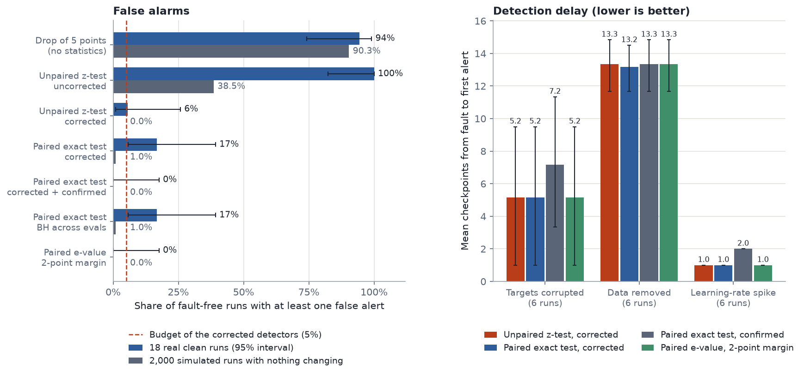
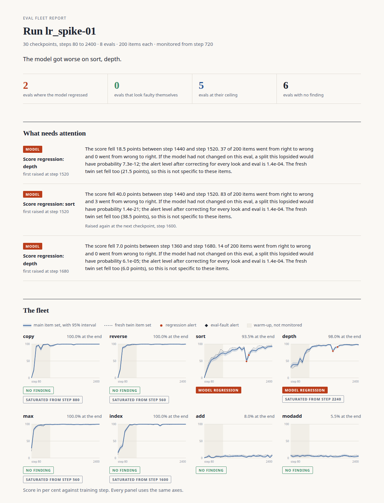

# Eval-Fleet_training-run-monitor

**When a score drops in the middle of a training run, is the model worse, is it noise, or
is the eval broken?**

This is a monitor for a fleet of evals scored at every checkpoint of a training run. It
answers two questions with stated false-alarm rates: has the model really regressed on
something, and has an eval stopped measuring what it was meant to? I validated it on 48
real training runs of small models, 30 of them with a fault injected at a known step, so
that false alarms, detection power and detection delay are measured against the truth
rather than argued for.



## What was found

The full write-up is in [REPORT.md](REPORT.md). The plan, with ten hypotheses and their
decision rules, was committed before the experiments ran and is in [PLAN.md](PLAN.md).

| Detector | Clean runs with a false alert (of 18) | Same, simulated runs where nothing changes (of 2,000) | Real regressions flagged (of 11 that moved the model 5 points or more) | Smallest planted drop caught 9 times in 10 |
|---|---|---|---|---|
| Score fell 5 points since the last checkpoint | 17 | 1,807 | 11 | 6 points |
| Unpaired z-test, p < 0.05, every look | 18 | 770 | 11 | not run |
| Unpaired z-test, corrected for all looks | 1 | 0 | 10 | 10 points |
| **Paired exact test, corrected (primary)** | **3** | **20** | **11** | **8 points** |
| Paired exact test, confirmed at the next look | 0 | 0 | 9 | 15 points |
| Paired e-value with a 2-point margin | 0 | 0 | 10 | 15 points |

Each eval has 200 items; a run has 8 evals and 22 monitored checkpoints. "Corrected"
means one budget of 5% per run, split over every look, eval and comparison.

- **The usual rules cry wolf on almost every run.** A 5-point drop rule raised a false
  alert in 17 of 18 fault-free runs, an uncorrected z-test in all 18.
- **The corrected tests keep their promise when nothing changes, and only then.** In
  2,000 simulated runs with no change at all, the paired exact test alarmed in 20 (1.0%). On
  the 18 real clean runs it alarmed in 3 (17%, 95% interval 6 to 39%). Two of the three
  were real one-checkpoint dips in the model, of 20 and 9 points on fresh items, that
  healed by the next checkpoint. The statistics cover the luck of which items are in the
  eval. They do not cover training noise.
- **Asking for the alert twice in a row removed all three**, for one checkpoint of delay.
- **Every injected regression that really moved the model was caught.** 11 of the 18
  injected regressions lowered the score on fresh items by 5 points or more; the paired
  test flagged all 11, 10 of them at the first checkpoint. The other 7 moved the model by
  less than 5 points and none was flagged. I had not expected so many faults to do so
  little, and the power prediction failed as written.
- **Pairing helped less than I predicted.** Paired and unpaired tests had the same delay
  in 17 of 18 regression runs. With drops of known size planted in the clean runs, the
  paired test needed 8 points to be reliable and the unpaired one 10.
- **A grader bug looks exactly like a regression.** In all 6 grader-bug runs every
  regression detector fired at the first affected checkpoint. A second grader on the same
  outputs caught all 6 at that checkpoint, and the verdict was "eval fault", not "model
  regression" (5 runs cleanly, 1 alongside a real dip on the same eval).
- **Contamination is invisible to a regression detector** (0 of 6) and visible against a
  fresh twin set of items: 5 of 6 leaks were flagged, 4 to 10 checkpoints after they began.
- Seven of the ten hypotheses were supported and three failed. The report says which and
  why.

These are 105,000-parameter models on synthetic skills. They are a test bed for the
monitor. Nothing here is evidence about how large language models train.

## The report for one run

`evalfleet report` writes one self-contained HTML file per run: score trajectories with
intervals, alerts explained in plain English, and eval-health flags. Three examples are
committed: [a learning-rate spike](docs/example_report.html),
[a grader bug](docs/example_report_grader_bug.html) and
[contamination](docs/example_report_contamination.html) (download and open in a browser).



## Use the detectors on your own eval results

You need item-level results: for every checkpoint, every eval and every item, whether the
answer was right. Put them in a CSV with the columns `step,eval,item,correct`
(every eval needs the same number of items):

```
step,eval,item,correct
80,copy,0,0
80,copy,1,0
...
```

```bash
uv run evalfleet export --run results/runs/corrupt-04.npz --csv my_results.csv   # an example file in that format
uv run evalfleet monitor --csv my_results.csv
```

```
30 checkpoints, 8 evals, 200 items each; monitoring from step 720
eval        final  reliab.  verdict
add         26.0%     0.95  No finding
copy       100.0%     0.53  No finding  (saturated from step 560)
depth       98.0%     0.97  No finding  (saturated from step 1760)
index      100.0%     1.00  No finding  (saturated from step 560)
max         94.0%     0.97  Model regression
...
[regression @ step 1600] max: the score fell 15.0 points between step 1520 and step 1600.
30 of 200 items went from right to wrong and 0 went from wrong to right. If the model had
not changed on this eval, a split this lopsided would have probability 9.3e-10; the alert
level after correcting for every look and eval is 1.4e-04. ...
```

Or from Python, with the optional twin item set and second grader:

```python
import numpy as np
from evalfleet.monitor import monitor_run, text_summary

# score[checkpoint, eval, item] is True where the item was answered correctly
report = monitor_run(score, steps=steps, evals=["qa", "code"],
                     twin=twin_score,        # optional: same evals, fresh items
                     regrade=second_grader)  # optional: same outputs, another grader
print(text_summary(report))
for alert in report.alerts:
    print(alert.kind, alert.eval, alert.step, alert.detail)
```

`--first-look` sets the first monitored checkpoint (default: the 9th) and `--alpha` the
false-alarm budget per run (default 0.05). The budget is split over the checkpoints in
the file, so it assumes the run length is known in advance.

## What is in the repository

| Part | File | What it does |
|---|---|---|
| Skills and items | `src/evalfleet/skills.py` | Eight text skills, each with a training generator and fixed `main` and `twin` item sets |
| Model | `src/evalfleet/model.py` | A 2-layer decoder-only transformer, 105,244 parameters |
| Faults | `src/evalfleet/faults.py` | The five injected faults and their onset logic |
| Graders | `src/evalfleet/grader.py` | The production grader (with the injectable bug) and the reference grader |
| Training | `src/evalfleet/train.py` | One run: 2,400 steps, 30 checkpoints, deterministic given a seed |
| Evaluation | `src/evalfleet/evaluate.py` | Scores every item at every checkpoint with both graders; bit-packed `.npz` per run |
| Runner | `src/evalfleet/runner.py` | The 48-run matrix; skips runs that are already done |
| Statistics | `src/evalfleet/stats.py` | Wilson, z-test, Fisher, McNemar, betting e-value, alpha spending, Benjamini-Hochberg, split-half reliability |
| Detectors | `src/evalfleet/detectors.py` | Seven regression detectors and the eval-health checks, vectorised over a run |
| Monitor | `src/evalfleet/monitor.py` | Alerts with explanations, verdict per eval, CSV loader |
| Study | `src/evalfleet/study.py` | Scores the detectors against the known faults; writes `results/summary.json` |
| Figures | `src/evalfleet/figures.py` | Every figure in this README and the report |
| HTML report | `src/evalfleet/report.py` | One self-contained `.html` per run |
| Results | `results/runs/*.npz`, `results/summary.json` | Item-level results of all 48 runs (514 kB in total) and every number quoted here |
| Tests | `tests/` | 59 tests |

## Reproduce it

You need Python 3.11 or newer and [uv](https://docs.astral.sh/uv/). No GPU is used. Times
are from a 4-core, 8-thread laptop CPU that was busy with other jobs; a quiet machine is
faster.

```bash
git clone https://github.com/AmosBunde/Eval-Fleet_training-run-monitor
cd Eval-Fleet_training-run-monitor
uv sync --extra dev          # installs CPU PyTorch, NumPy, SciPy, Matplotlib, pytest
uv run pytest -q             # 59 tests, 1 to 3 minutes
```

The item-level results of my runs are in the repository, so steps 3 to 6 work straight
after cloning. Steps 1 and 2 retrain from scratch.

| Step | Command | Time | Writes |
|---|---|---|---|
| 1. Train, score and monitor one run, to check the setup | `uv run evalfleet train --run-id demo --seed 1 --fault remove --skill sort --onset 1280`, then `uv run evalfleet evaluate --checkpoints results/checkpoints/demo`, then `uv run evalfleet monitor --run results/runs/demo.npz` | about 2 min | `results/checkpoints/demo/` (not in git), `results/runs/demo.npz` |
| 2. Run the whole matrix | `uv run evalfleet matrix --workers 3` | 51 min on my machine (151 process-minutes) | `results/runs/*.npz` |
| 3. Look at one run | `uv run evalfleet monitor --run results/runs/lr_spike-01.npz` | seconds | text on the terminal |
| 4. Score the detectors | `uv run evalfleet summarise` | 1 to 2 min | `results/summary.json` |
| 5. Draw the figures | `uv run evalfleet figures` | seconds | `docs/img/*.png` |
| 6. Write an HTML report | `uv run evalfleet report --run results/runs/lr_spike-01.npz --out docs/example_report.html` | seconds | one `.html` file |

On my machine step 1 ended with `sort` at 69.0% and a model regression reported on
`sort`; individual items can differ on another machine. Step 3 should report a
model regression on `sort` and `depth` first raised at step 1520, the first checkpoint
after the learning-rate spike. Step 4 prints each hypothesis with its outcome and should
reproduce the committed `results/summary.json` exactly from the committed run files.

Step 2 skips any run whose result file exists, so it can be stopped and restarted; delete
`results/runs/` first to retrain everything. Delete `results/runs/demo.npz` after step 1
if you do not want the demo run counted in step 4. Training is deterministic for a given
seed on one machine (tested); on another machine or PyTorch build expect the same picture
with different individual items.

## Limits

- **Tiny models, synthetic skills.** The test bed exists so that faults can be injected
  and the truth known. Effect sizes, delays and the amount of training noise will differ
  on real models and real evals.
- **18 clean runs.** A run-level false-alarm rate of 3 in 18 has a 95% interval of 6 to
  39%. The claim that the paired test exceeds its 5% budget on real runs rests on that
  interval and on a second sample of items (4 of 18).
- **The faults were large or negligible.** Few landed between 5 and 10 points, where
  detectors differ. The planted-drop analysis fills that gap but was added after seeing
  the results, and it plants a clean, permanent loss of items, which is the easy case for
  a paired test.
- **Exact match on fixed items.** Nothing here handles graded scores, sampled outputs or
  items whose difficulty depends on each other.
- **The guarantee is against item-sampling noise only.** It says nothing about run-to-run
  or checkpoint-to-checkpoint variation in the model, and the results show that this
  matters.
- **The grader check compares two graders I wrote.** It is close to deterministic. Its
  value is in showing what the regression detectors would have concluded without it.
- **The correction is conservative** (a union bound over 352 tests). A less conservative
  method would catch smaller drops, and would also flag more real dips.

## Licence

MIT. See [LICENSE](LICENSE).
