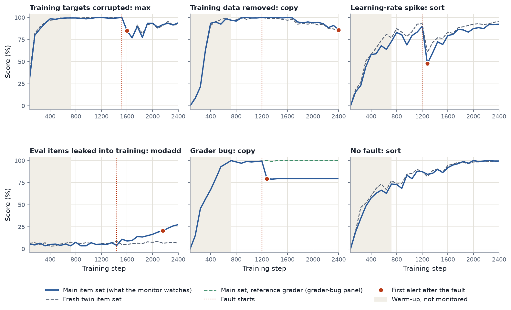
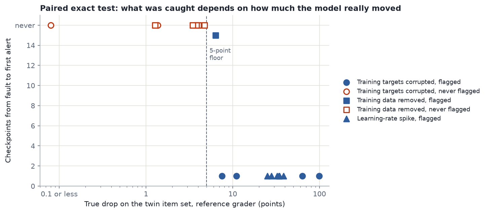
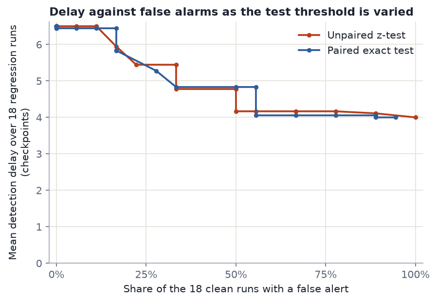
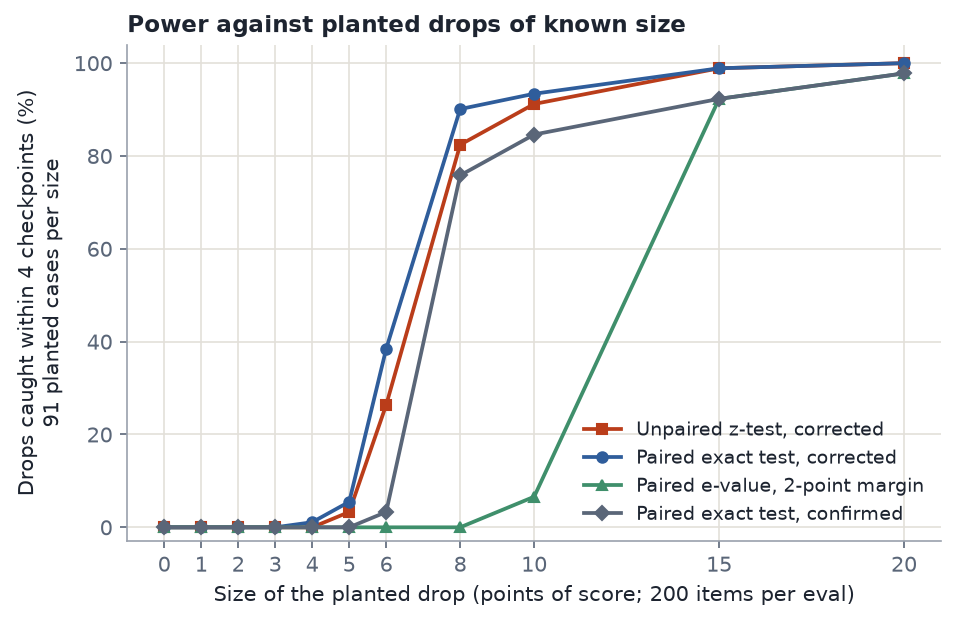
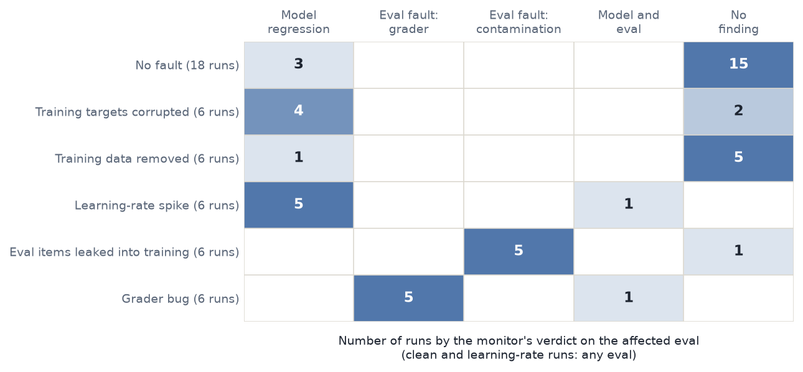
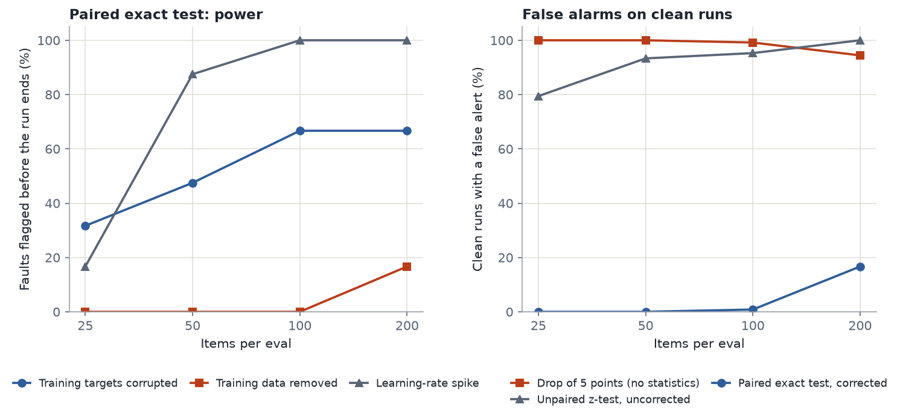

# Watching a fleet of evals during a training run: what can be detected, and how soon?

Amos Bunde, November 2026

## Summary

I built a monitor for a fleet of eight evals scored at every checkpoint of a training
run, and measured how it behaves on 48 real training runs of small transformers: 18 clean
runs and 30 with one fault injected at a known step. The faults were real regressions
(corrupted training targets, removed training data, a learning-rate spike) and
measurement faults in which the model is fine and the eval is not (eval items leaking
into training, a grader bug).

The rules people usually reach for raised a false alert in 17 and 18 of the 18 clean
runs. A paired exact test on the items that flipped, corrected for all 352 tests in a
run, alarmed in 1.0% of 2,000 simulated runs where nothing changes, as designed. On the
18 real clean runs it alarmed in 3 (95% interval 6 to 39%), because real runs contain
real one-checkpoint dips. Asking for the alert at two checkpoints in a row removed all
three, at a cost of one checkpoint of delay.

Of 18 injected regressions, 11 really lowered the score on fresh items by 5 points or
more, and the paired test flagged all 11, 10 at the first checkpoint. The other 7 did
little to the model and none was flagged. I predicted that paired tests would detect
earlier than unpaired ones; in these runs they did not (same delay in 17 of 18). The
grader bug was caught at the first checkpoint in all 6 runs and blamed on the eval;
without the second grader every regression detector would have blamed the model.
Contamination was flagged in 5 of 6 runs, 4 to 10 checkpoints after it began.

Seven of ten hypotheses were supported and three failed. The study is small and the
models are tiny: it shows how such a monitor behaves when the truth is known, not what
will happen on large models.

## 1. Question

A training run is watched through its evals. Every time a checkpoint is saved, a set of
evals is scored and somebody (or something) looks at the numbers. Two questions keep
coming up:

1. Has the model really got worse at something, or is this noise?
2. Has an eval stopped measuring what it was meant to measure?

The first question is a statistics problem with a twist. A fleet of 8 evals looked at 22
times is 176 chances to be fooled, more if each look compares against several earlier
checkpoints. A rule that is wrong 5% of the time per look is wrong somewhere in almost
every run. People then learn to ignore the alerts.

The second question is usually not asked at all. A score can rise because eval items
leaked into the training data, or fall because a change to the harness started marking
correct answers wrong. Both look, on a dashboard, like the model changing.

I wanted to know how well a monitor can answer both questions when the truth is known:
how often it raises a false alarm on runs with no fault, how many checkpoints it takes to
notice a real one, and whether it blames the right party. Evals on large models rarely
come with known truth, so I built a test bed where faults are injected on purpose.

## 2. Test bed

### 2.1 Models and skills

Each run trains a small decoder-only transformer (2 layers, width 64, 4 heads, 105,244
parameters) from scratch on a mix of eight text skills. A training example is a
line `<tag>:<input>=<answer>`; the model learns to continue after `=`.

| Skill | Example | What it tests |
|---|---|---|
| `copy` | `c:40713=40713` | repeat 3 to 6 digits |
| `reverse` | `r:40713=31704` | reverse 3 to 6 digits |
| `sort` | `s:40713=01347` | sort 3 to 6 digits |
| `depth` | `d:([()])()=3` | deepest nesting of a balanced bracket string |
| `max` | `x:40713=7` | largest of 4 to 7 digits |
| `index` | `i:2\|40713=0` | the digit at a given position |
| `add` | `a:47+85=132` | add two numbers below 100 |
| `modadd` | `m:47+85=13` | add two numbers below 100, modulo 17 |

A run is 2,400 steps of batch size 64 with a checkpoint every 80 steps: 30 checkpoints.
Training one run took 152 seconds on average on one CPU thread of a shared
machine, and scoring its 30 checkpoints another 37 seconds.

By the end of a clean run `copy`, `reverse`, `max` and `index` score 99.7% or more on average over the 18 clean runs, `sort` 98.4% and `depth` 97.6%. `add` reaches 14.1% and `modadd` 5.75%: the model has not learned them in this budget. That spread is useful. The fleet contains evals at their ceiling, evals
still moving, and evals the model cannot yet do.

### 2.2 Evals

Each skill has an eval of 200 fixed items, the `main` set, and a second set of 200 items
drawn from the same stream, the `twin` set. Neither set ever appears in the training
data. Every item is scored at every checkpoint, exact match, and the item-level results
are kept: 30 x 8 x 2 x 200 right/wrong bits per run.

Each output is graded twice. The production grader is what the monitor watches; it keeps
a fixed number of answer characters, as a harness with a generation limit does. The
reference grader is a second, simpler implementation that never truncates.

### 2.3 Injected faults

One fault per run, starting after a known checkpoint between the 15th and the 21st.

| Kind | What is done | Family |
|---|---|---|
| `corrupt` | 100%, 50% or 25% of one skill's training targets are replaced by the answer to a different input | real regression |
| `remove` | one skill's training data stops | real regression |
| `lr_spike` | the learning rate is multiplied by 10 for 40 steps | real regression |
| `contaminate` | the 200 main items of one skill are fed into training (100% or 50% of that skill's examples) | measurement fault |
| `grader_bug` | the production grader's limit is set one character too low, so correct answers of full length are marked wrong | measurement fault |

The matrix is 18 clean runs and 6 runs of each fault, 48 runs with 48 different seeds.
`corrupt` and `remove` rotate over the six learned skills, `contaminate` over `add` and
`modadd`, `grader_bug` over `copy`, `reverse` and `sort`.

*One run of each kind. The blue line is what the monitor watches. In the two measurement
faults (bottom left and middle) the model's real skill, shown by the dashed line, does not
do what the blue line does.*

## 3. Detectors

Monitoring starts at the 9th checkpoint (step 720) and covers 22 looks. Earlier
checkpoints are warm-up: scores move by tens of points and nobody would page on them.

### 3.1 Regression detectors

Each produces "alert on eval k at checkpoint t".

| Name | Rule |
|---|---|
| `threshold` | the score fell 5 points or more since the previous checkpoint |
| `z_naive` | unpaired two-proportion z-test against the previous checkpoint, one-sided, p < 0.05 |
| `z_seq` | the same test against the checkpoints 1 and 4 back, corrected |
| `mcnemar_seq` | exact McNemar test [1] against the checkpoints 1 and 4 back, corrected (the primary detector) |
| `mcnemar_confirm` | `mcnemar_seq` must alert at two looks in a row |
| `mcnemar_bh` | as `mcnemar_seq`, with Benjamini-Hochberg [2] across the evals at each look |
| `evalue_seq` | a paired e-value against "the score fell by at most 2 points", corrected |

**Paired or unpaired.** Two checkpoints scored on the same 200 items agree on most of
them. The unpaired z-test ignores that and treats the two scores as independent samples.
The McNemar test looks only at the items that flipped: if the model has not changed, a
flipped item is as likely to have gone right-to-wrong as wrong-to-right, so the number
lost is Binomial(flips, 1/2). It is exact at any sample size. Pairing eval items is the
standard advice for comparing two models [3, 4]; here the two models are two checkpoints.

**Two lags.** A sudden collapse shows against the previous checkpoint. A slow decline
does not: each step is too small. Comparing against the checkpoint four back as well
catches declines that add up.

**Correction for repeated looks.** A run has 22 looks, 8 evals and 2 lags: 352 tests. One
budget of 0.05 is split evenly over all of them, 1.4e-4 each. This is alpha spending in
its simplest form [5], with a union bound in place of a joint distribution. The bound
holds under any dependence between looks, which matters because consecutive comparisons
share checkpoints and items. The price is conservatism.

**The e-value.** For each item let d be +1 if it was lost, -1 if gained, 0 otherwise. The
null "the score fell by at most 2 points" says the mean of d is at most 0.02. For a fixed
bet size, the product over items of (1 + bet x (d - 0.02)) has expectation at most 1
under that null, so it is an e-value [6, 7]; I average over seven bet sizes. An e-value of
1/alpha or more rejects at level alpha by Markov's inequality, with no normal
approximation. Averaging the e-values of the two lags is allowed [7], so the lags cost no
budget. The margin means small real wobbles are not evidence.

What I did not build: a test martingale that runs across checkpoints. The looks are not a
stream of fresh data about one hypothesis. Each look re-scores the same items on a new
model and asks a new question, so the honest tool is a correction over a family of tests.

### 3.2 Eval-health checks

- **Contamination.** Main and twin are two draws of items from one distribution, so with
  no leak any item-level quantity has the same rate in both. Fisher's exact test compares
  them on (a) items right now and (b) items right now that were wrong just before
  monitoring began. The second ignores items the model could already do and is more
  sensitive to a slow leak. This is the fresh-test-set idea of [8] applied at every
  checkpoint. Budget 0.05 over 22 looks, 8 evals and the 2 tests.
- **Grader self-consistency.** The number of items on which the two graders disagree,
  tested against a tolerated rate of 0.5% with an exact binomial test. Budget 0.05 over 22
  looks and 8 evals.
- **Saturation.** 98% or more at three consecutive checkpoints.
- **Split-half reliability.** Items are split at random into halves; the half-scores are
  correlated across checkpoints and stepped up with the Spearman-Brown formula.

### 3.3 Verdict

A score drop is not a statement about the model. The monitor blames the model only if
the paired test also alerts on the reference-graded scores. If the grader check alerts,
the verdict is "eval fault: grader"; if the twin check alerts, "eval fault:
contamination".

### 3.4 How the detectors are scored

- **False alarm.** A clean run in which a detector alerts on any eval at any look.
- **Delay.** Checkpoints from the fault to the first alert on the affected eval (any
  eval for `lr_spike`). 1 means the first checkpoint after the fault. A fault never
  flagged counts as the number of checkpoints left in the run plus one.
- **True effect.** How much the model really changed, measured on the twin set with the
  reference grader, which no regression detector sees.

## 4. Results

All numbers are in `results/summary.json`; the item-level results of every run are in
`results/runs/`. Hypotheses are judged by the rules written in PLAN.md before the runs.

### 4.1 False alarms (H1, H2a, H2b, H2c)

Runs in which a detector raised at least one alert although no fault was injected:

| Detector | 18 real clean runs (95% interval) | Same runs, twin items monitored | 2,000 simulated runs, nothing changing |
|---|---|---|---|
| `threshold` | 17 (74 to 99%) | 17 | 1,807 |
| `z_naive` | 18 (82 to 100%) | 18 | 770 |
| `z_seq` | 1 (1 to 26%) | 3 | 0 |
| `mcnemar_seq` | 3 (6 to 39%) | 4 | 20 |
| `mcnemar_confirm` | 0 (0 to 18%) | 0 | 0 |
| `mcnemar_bh` | 3 (6 to 39%) | 4 | 20 |
| `evalue_seq` | 0 (0 to 18%) | 1 | 0 |

The middle column repeats the analysis with the twin set in the role of the monitored
set: the same 18 models, a second sample of items. The simulated runs give every item a
fixed chance of being right at every checkpoint, so every tested null is exactly true.

**H1, naive detectors over-alarm: supported.** The 5-point rule alarmed in 17 of 18 clean
runs and the uncorrected z-test in all 18, with 2.3 and 3.9 false alerts per run.

**H2a, the corrected detectors hold 5% under an exact null: supported.** The worst was
20 of 2,000 (1.0%). The detectors are conservative, as a union bound over exact tests
should be. The contamination check alarmed in 20 of 2,000 and the grader check in 26.

**H2b, the guarantee does not carry over to real clean runs: supported.** The paired
exact test alarmed in 3 of 18 clean runs, and in 4 of 18 on the twin items. The three
alerts:

- `clean-09`, `sort`: 15.5 points lost in one checkpoint (47 items lost, 16 gained). The
  twin set lost 20.0 points at the same checkpoint. The next checkpoint was back up.
- `clean-12`, `depth`: 10.0 points lost (24 lost, 4 gained); the twin set lost 9.0. Back
  up at the next checkpoint.
- `clean-14`, `sort`: 7.5 points lost (16 lost, 1 gained); the twin set did not follow.

The first two are not statistical errors. The model really was worse at those
checkpoints, on fresh items too, and then recovered. The test answers "did the model
change on this eval?" correctly; the answer is just not what an operator means by a
fault. The third may be an ordinary item-noise false alarm.

The simulation also flatters the naive z-test: 770 of 2,000 simulated runs (38.5%)
against 18 of 18 real ones. A null model without training noise understates false alarms
for every detector.

**H2c, confirmation fixes most of that cheaply: supported.** Requiring the alert at two
consecutive looks left 0 of 18 clean runs alarmed (0 of 18 on the twin items) and added
1.06 checkpoints of mean delay over the 18 regression runs. It is not free. It lost 2 of
the 11 regressions that took effect (section 4.2): one where the score partly recovered
at the next checkpoint, so the second look did not reject, and one slow decline first
flagged at the last checkpoint of the run, where there is no next look. It also needs
larger drops (section 4.3).

### 4.2 Detection of real regressions (H4)

| Fault | Runs | Mean true effect (points) | Flagged by `mcnemar_seq` | At the first checkpoint | Mean delay (95% interval) |
|---|---|---|---|---|---|
| `corrupt` | 6 | 30.4 | 4 | 4 | 5.2 (1.0 to 9.5) |
| `remove` | 6 | 3.95 | 1 | 0 | 13.2 (11.7 to 14.5) |
| `lr_spike` | 6 | 32.1 | 6 | 6 | 1.0 (1.0 to 1.0) |

**H4, power: failed.** I predicted every `corrupt` run flagged at once (got 4 of 6), at
least 4 of 6 `remove` runs flagged (got 1) and at least 3 of 6 `lr_spike` runs (got 6).

The reason is that many injected faults did not do much. The true effect, measured on
the twin set with the reference grader, was:

- `corrupt`: 99.1 points (`copy`, all targets), 63.5 (`depth`, all), 11.1 (`max`, half),
  7.5 (`sort`, a quarter), 1.4 (`reverse`, half) and 0.0 (`index`, a quarter). A small
  model shrugs off a quarter or a half of wrong targets on a skill it has mastered.
- `remove`: 6.4, 4.7, 4.0, 3.8, 3.5 and 1.3 points. With 720 to 1,200 steps left, a skill
  that is no longer trained decays slowly.

Splitting the 18 runs by whether the true effect reached 5 points (a split I chose after
seeing the data, PLAN.md amendment 2):

| | Runs | Mean true effect | `mcnemar_seq` flagged | at first checkpoint | `z_seq` | `evalue_seq` | `mcnemar_confirm` |
|---|---|---|---|---|---|---|---|
| Effect of 5 points or more | 11 | 34.5 points | 11 | 10 | 10 | 10 | 9 |
| Effect below 5 points | 7 | 2.7 points | 0 | 0 | 0 | 0 | 0 |

The largest effect that went unflagged was 4.7 points and the smallest that was flagged
was 6.4 points (after 15 checkpoints). That matches the arithmetic of the test: at
1.4e-4 per test, the sign test needs 13 items lost with none gained, 6.5 points of a
200-item eval. Below that, the monitor is blind by construction, and the health table of
the HTML report prints this figure for each eval.

An injected fault is not the same thing as a regression. Had I scored detection against
"a fault was injected" alone, the monitor would look weak; had I only kept the faults it
caught, it would look perfect. Measuring the effect on data the detector never sees is
what separates the two.

### 4.3 Paired against unpaired (H3)

**H3, paired tests detect earlier than unpaired ones: failed.** Over the 18 regression
runs the mean delay was 6.50 checkpoints for `z_seq` and 6.44 for `mcnemar_seq`: a
difference of 0.06 (95% interval 0.00 to 0.17). The paired test was earlier in 1 run,
the same in 17 and later in none. With thresholds tuned to equal measured false-alarm
rates the paired test was not better either:

| Target share of clean runs alarmed | Unpaired: share reached, mean delay | Paired: share reached, mean delay |
|---|---|---|
| at most 1/8 | 2 of 18, 6.50 | 2 of 18, 6.44 |
| at most 1/4 | 4 of 18, 5.44 | 3 of 18, 5.83 |
| at most 1/2 | 9 of 18, 4.17 | 9 of 18, 4.83 |

The faults in this test bed were either large enough for any test or too small for
every test, so the comparison had almost nothing to work with. The paired test is also
more sensitive to the real dips in clean runs, which is why it needs a stricter
threshold to reach the same false-alarm rate.

To find where the two tests part, I planted drops of known size in the clean runs (post
hoc, PLAN.md amendment 3). In each of the 18 clean runs, for each eval scoring 90% or
more just before step 1360, a set number of items that were right were marked wrong from
that step on: 91 cases per size. A drop counts as caught if the detector alerts within 4
checkpoints.

| Planted drop (points) | 4 | 5 | 6 | 8 | 10 | 15 | 20 |
|---|---|---|---|---|---|---|---|
| `threshold` | 9% | 63% | 92% | 99% | 100% | 100% | 100% |
| `z_seq` | 0% | 3% | 26% | 82% | 91% | 99% | 100% |
| `mcnemar_seq` | 1% | 5% | 38% | 90% | 93% | 99% | 100% |
| `mcnemar_confirm` | 0% | 0% | 3% | 76% | 85% | 92% | 98% |
| `evalue_seq` | 0% | 0% | 0% | 0% | 7% | 92% | 98% |

The paired test is ahead, by a modest margin: it catches 9 in 10 from 8 points, the
unpaired test from 10. The margin is small because these evals sit near their ceiling.
An unpaired test's variance is p(1 - p), which is already small at 95%. Pairing pays
most when scores are mid-range and items are stable; a unit test shows a case (16 items
lost from 100 of 200 right) that the paired test flags and the unpaired test does not.
The 5-point rule catches smaller drops than anything else, and is useless, because it
also fires on 17 of 18 clean runs.

### 4.4 Blaming the right party (H5)

Verdict on the affected eval (any eval for clean and `lr_spike` runs):

**H5, measurement faults are blamed on the eval: failed by its rule.** The rule asked for
all 6 `grader_bug` runs to get "eval fault: grader" alone (5 did), at least 4 of 6
`contaminate` runs to get "eval fault: contamination" alone (5 did), and no real
regression to get an eval-fault verdict (1 did).

Of the 12 measurement-fault runs, 10 were blamed on the eval alone, 1 on both and 1 on
nobody. None was blamed on the model alone. The details:

- **Grader bug.** The grader check fired at the first affected checkpoint in all 6 runs.
  So did every regression detector, naive or corrected: the score really did fall, by 20
  points on `copy` in the example. Without the second grader, all 6 would have been
  reported as model regressions. In one run (`grader_bug-02`) `sort` also had a real dip
  of the kind seen in clean runs, so the verdict was both.
- **Contamination.** The twin check flagged 5 of 6 runs, at 4, 4, 6, 9 and 10 checkpoints
  after the leak began (mean delay 8.0 counting the miss; 95% interval 5.2 to 11.3). The
  miss was `modadd` with half of its training examples leaked. No regression detector,
  naive or corrected, fired on any contaminated eval: a rising score is not something
  they look for.
- **One spurious contamination flag.** In `lr_spike-00` the twin check fired on `sort`
  after the spike. Nothing had leaked. One false flag in 48 runs is inside the check's 5%
  budget, but it is the reason H5 fails on its third clause.
- **A grader disagreement I did not inject.** In two `corrupt` runs the grader check
  fired on an eval that was not the corrupted one (`max` in `corrupt-02`, `depth` in
  `corrupt-04`), with up to 10 of 200 items in dispute. In every such case the production
  grader said right and the reference grader said wrong. From the grader code that can
  only mean one thing: the model gave the right answer and then failed to stop. The
  production grader cuts the output at the answer's maximum length and never sees the
  extra characters. Neither grader is wrong; they disagree about what counts. I had not
  planned this, and the check found it.

### 4.5 Small evals (H6)

Random subsets of the 200 items (20 draws per size), same detector settings:

| Items per eval | Smallest drop the paired test can flag | Regressions flagged (18 runs) | `lr_spike` flagged | Clean runs alarmed, `mcnemar_seq` | Clean runs alarmed, `threshold` | Median split-half reliability |
|---|---|---|---|---|---|---|
| 25 | 52 points | 16% | 17% | 0% | 100% | 0.27 |
| 50 | 26 points | 45% | 87.5% | 0% | 100% | 0.47 |
| 100 | 13 points | 56% | 100% | 0.8% | 99.2% | 0.61 |
| 200 | 6.5 points | 61% | 100% | 16.7% | 94.4% | 0.70 |

**H6: supported by its rule, for a dull reason.** The rule compared power on `remove`
runs at 25 and 200 items: 0% against 17% (1 of 6). Since `remove` was barely detectable
at any size, that says little. The table is more useful. A 25-item eval cannot flag
anything short of a collapse, and at the same time the 5-point rule fires on it in every
clean run (9.9 false alerts per run). Small evals are both blind and noisy.

Going the other way (post hoc, amendment 4), pooling main and twin into 400 items lowers
the floor to 3.25 points and flags 15 of the 18 regression runs instead of 11, with a
mean delay of 3.8 checkpoints instead of 6.4. It also alarms on 7 of 18 clean runs. More
items do not buy a quieter monitor. They buy a more sensitive one, and it then sees more
of the real wobble.

### 4.6 A margin instead of confirmation (H7)

**H7: supported by its rule.** The e-value detector raised no false alert in the 18
clean runs (0.17 per run for `mcnemar_seq`; 1 of 18 on the twin items) and its mean delay
on the regression runs was 0.06 checkpoints longer. That reads better than it is. The
real faults were large, so the margin cost nothing. The planted drops in 4.3 show the
price: the e-value needs a 15-point drop to be reliable, where the exact test needs 8.
Markov's inequality is a blunt way to turn evidence into a decision.

### 4.7 Saturation and reliability (H8)

**H8: supported.** At the end of the 18 clean runs, 95 of 144 evals were flagged as
saturated (all 18 runs for `copy`, `reverse`, `max` and `index`; 13 for `depth`; 10 for
`sort`). In all 95 the twin set averaged 97% or more over the same three checkpoints, so
the flag reflects the skill and not a lucky set of items.

Median split-half reliability over the monitored checkpoints was 0.97 for `sort` and 0.95
for `depth`, the two evals still moving; 0.52 to 0.82 for the four at their ceiling; 0.64
for `add`; and -0.35 for `modadd`, which sits at chance. Low reliability marks the evals
whose checkpoint-to-checkpoint movement is mostly noise, at either end of the scale.

### 4.8 Scorecard

| | Hypothesis | Outcome |
|---|---|---|
| H1 | Naive detectors alarm in more than half of clean runs | supported (17 and 18 of 18) |
| H2a | Corrected detectors alarm in at most 5% of runs under an exact null | supported (at most 1.0%) |
| H2b | The paired exact test exceeds 5% on real clean runs | supported (3 of 18) |
| H2c | Confirmation at most halves that, for at most 1.5 checkpoints | supported (0 of 18; 1.06) |
| H3 | Paired tests detect earlier than unpaired | failed |
| H4 | Power: all `corrupt` at once, 4 of 6 `remove`, 3 of 6 `lr_spike` | failed (4, 1, 6) |
| H5 | Measurement faults blamed on the eval, real ones never | failed (5 of 6, 5 of 6, 1 misattributed) |
| H6 | Small evals lose power; the naive rule gets noisier | supported, weakly |
| H7 | A 2-point margin is quieter for at most one checkpoint | supported, see 4.3 for the cost |
| H8 | Saturation flags hold on the twin set | supported (95 of 95) |

## 5. What I take from this

1. **Two kinds of noise, one of them uncontrolled.** Item-level statistics control the
   luck of the item draw. They are silent about the model wobbling from checkpoint to
   checkpoint, and that wobble produced most of the false alarms here. A validity check
   on a simulated null would have passed every corrected detector. Only real clean runs
   showed the gap.
2. **Use the unconfirmed alert for the dashboard and the confirmed one for the pager.**
   Confirmation removed every false alert in these runs for one checkpoint of delay. It
   does miss dips that heal at once, which may be what you want from a pager.
3. **Measure what the fault did, not that it was injected.** Seven of 18 injected
   regressions were too small to matter. The twin set and the reference grader gave a
   measurement of the effect that no detector had seen.
4. **Redundancy beat cleverness.** A second grader and a second item set, both cheap,
   separated "the model changed" from "the eval changed" in 11 of 12 measurement-fault
   runs. No test on the main score alone could have done that. The choice between a
   paired and an unpaired test moved the detectable drop from 10 points to 8.
5. **Print the floor.** With 200 items and 352 tests, nothing under 6.5 points can be
   flagged. That figure belongs next to every eval on the dashboard, so that silence is
   not read as health.

## 6. Limits

- **The models are tiny and the skills synthetic.** About 105,000 parameters, exact-match
  string tasks. The amount of checkpoint-to-checkpoint wobble, the size of forgetting and
  the speed of memorisation will all differ on real models. The test bed says how the
  monitor behaves when the truth is known, nothing more.
- **18 clean runs.** Three alarms in 18 gives an interval of 6 to 39%. The second sample
  of items (4 of 18) is not independent of the first: the models are the same.
- **One training recipe.** A fairly high learning rate (2e-3) makes these runs jumpy. A
  smoother recipe would have fewer real dips and the gap between simulated and real
  false-alarm rates would be smaller.
- **The split by true effect, the planted drops and the pooled-items run are post hoc.**
  They explain the failures of H3 and H4; they do not rescue them.
- **Planted drops are the easy case.** Items are lost for good and none is gained. Real
  regressions churn: items are lost and gained together, which hurts a sign test.
- **The grader check is nearly deterministic** because both graders are simple and mine.
  Two real graders (say, a regex and a model-based judge) disagree at some base rate, and
  the tolerated rate of 0.5% would need calibrating.
- **Uniform spending assumes the number of checkpoints is known.** The code also has a
  schedule that does not (alpha / (t (t + 1))); I did not study it.
- **Fixed lags of 1 and 4.** A decline slower than a few points per four checkpoints is
  missed, as the `remove` runs show. A comparison against a fixed early reference would
  catch it, at the price of the selection problems that come with picking a reference.
- **The wall time overran.** The matrix took 51 minutes against a plan of 25 to 40.

## 7. What I would do next

1. Model the training noise. Estimate the checkpoint-to-checkpoint variance of each eval
   from clean runs and test against it, so that the stated false-alarm rate covers both
   kinds of noise.
2. Inject faults of graded size, aiming at true effects between 3 and 15 points, where
   the detectors differ.
3. Add mid-range evals. The paired test's advantage should be larger there, and this
   test bed had none between 15% and 95%.
4. Repeat on a public set of checkpoints of a larger model with a real benchmark and a
   second, differently built grader.
5. Replace the union bound with a method that uses the dependence between looks, and
   check on clean runs whether the extra power is worth the extra alarms.

## References

1. McNemar, Q. Note on the sampling error of the difference between correlated
   proportions or percentages. Psychometrika, 1947.
2. Benjamini, Y., Hochberg, Y. Controlling the false discovery rate: a practical and
   powerful approach to multiple testing. Journal of the Royal Statistical Society,
   Series B, 1995.
3. Dietterich, T. G. Approximate statistical tests for comparing supervised
   classification learning algorithms. Neural Computation, 1998.
4. Miller, E. Adding error bars to evals: a statistical approach to language model
   evaluations. arXiv:2411.00640, 2024.
5. Lan, K. K. G., DeMets, D. L. Discrete sequential boundaries for clinical trials.
   Biometrika, 1983.
6. Waudby-Smith, I., Ramdas, A. Estimating means of bounded random variables by betting.
   Journal of the Royal Statistical Society, Series B, 2024.
7. Vovk, V., Wang, R. E-values: calibration, combination and applications. Annals of
   Statistics, 2021.
8. Recht, B., Roelofs, R., Schmidt, L., Shankar, V. Do ImageNet classifiers generalize to
   ImageNet? ICML 2019.
